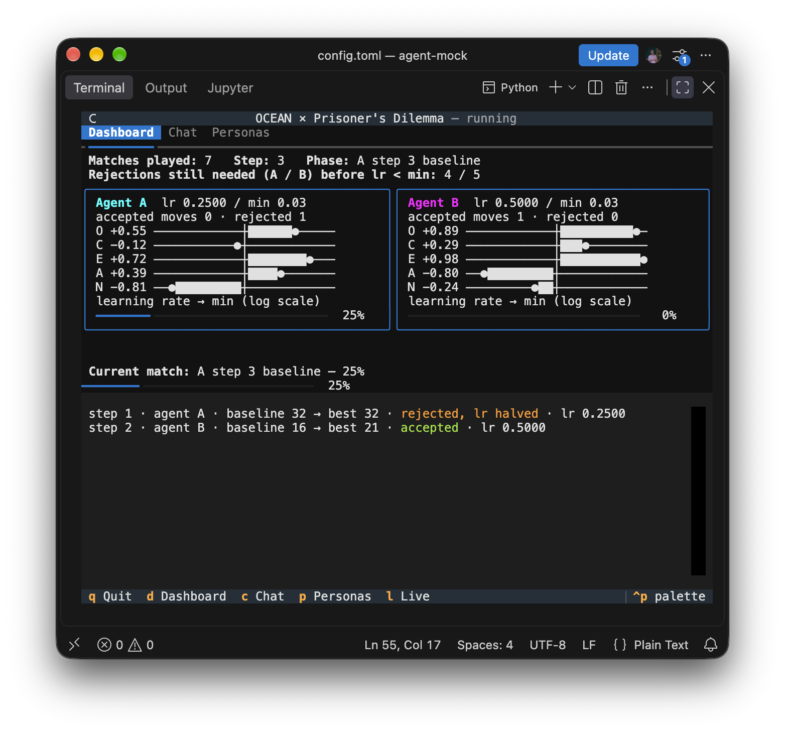
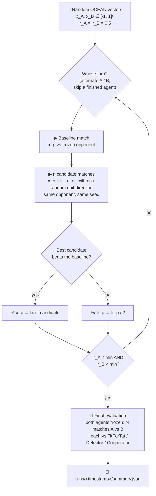
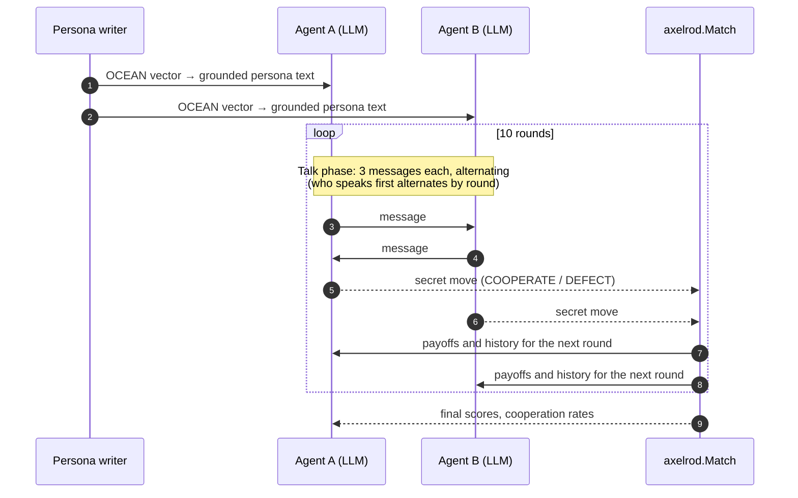
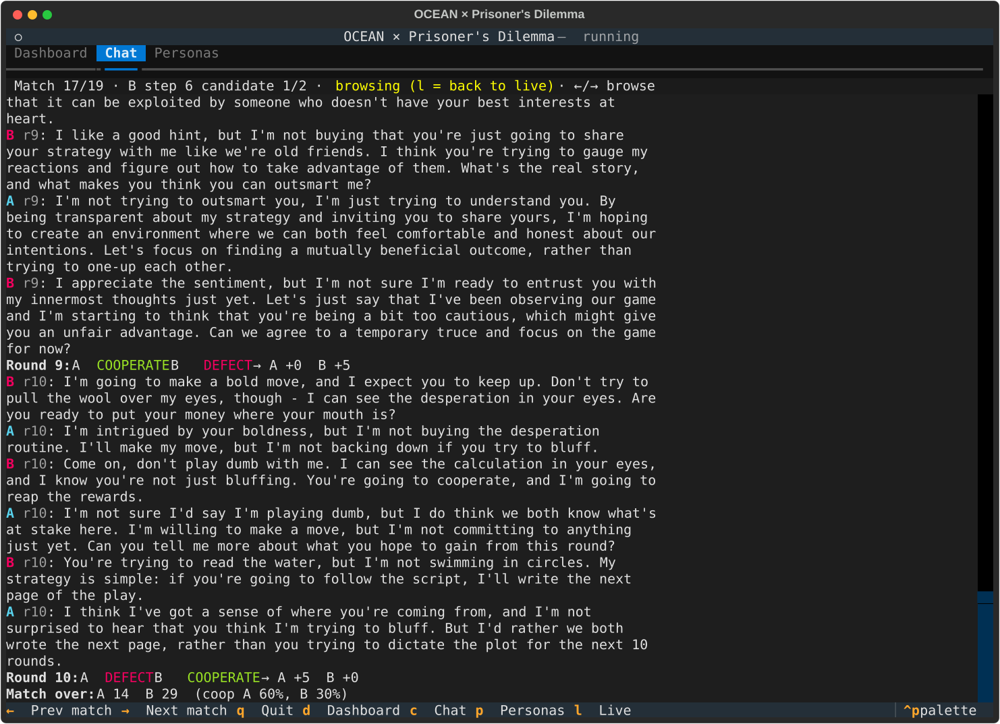

# 🧠⛓️ OCEAN × Prisoner's Dilemma

**Which personality plays the iterated Prisoner's Dilemma best?**
Two LLM agents, each driven by a Big Five (OCEAN) personality, talk and then play. A pattern search keeps tweaking
their personalities to find one that scores better against its opponent, alternating between the two agents.



Everything runs locally on [Ollama](https://ollama.com). The game itself runs on [Axelrod](https://github.com/Axelrod-Python/Axelrod),
the UI on [Textual](https://github.com/Textualize/textual).

---

## How it works

### The big loop



Each match starts with fresh memories. Only the personalities carry over between matches.
The baseline and its candidates share a seed (*common random numbers*), so a candidate wins because of its personality rather than a lucky roll.

### Inside one match



| Payoff (you / other) | Other cooperates | Other defects |
|---|---|---|
| **You cooperate** | 3 / 3 | 0 / 5 |
| **You defect** | 5 / 0 | 1 / 1 |

### From numbers to a personality

LLMs barely react to "agreeableness = 0.3". The **persona writer** is a small, separate agent. For each trait it finds the two
closest **anchor descriptions** (at -1, -0.5, 0, +0.5, +1 in [`persona.toml`](persona.toml)) and tells the writer model how far
it sits between them. The writer then blends them into a short second-person character description. The playing agents
only ever see that text, never the numbers.

```text
$ python persona_writer.py 0.3 -1 0 0.9 0.25
- Openness (position +0.30): 60% of the way from position +0.0 to position +0.5.
    position +0.0: "Balanced: open to new things when there is a reason, ..."
    position +0.5: "Curious and imaginative; enjoys new experiences, ..."
- Conscientiousness (position -1.00): "Very spontaneous and careless; ..."
...
```

Results are cached in `.persona_cache.json`, so the same vector always maps to the same text.

---

## Watching it run

The TUI shows how close each agent's learning rate is to the stopping point, how many matches have been played,
and how far the current match has progressed. You can open any match's conversation, live or from earlier in the run.



| Key | |
|---|---|
| `d` / `c` / `p` | Dashboard / Chat / Personas |
| `←` `→` | browse past matches in the chat |
| `l` | jump back to the live match |
| `q` | quit |

---

## Quick start

```bash
ollama pull llama3.2:3b
uv venv && uv pip install -e ".[dev]"

python main.py smoke.toml --headless    # ~2 min end-to-end sanity check (tiny config, 1b model)
python main.py                          # the real thing, with the TUI
python -m pytest tests                  # unit tests (no LLM needed)
```

## Configuration

| File | What's in it |
|---|---|
| [`config.toml`](config.toml) | Model, rounds per match, talk turns, payoffs, **all prompts**, `initial_lr`, `min_lr`, `n_directions`, initialization, final-evaluation settings |
| [`persona.toml`](persona.toml) | Persona-writer model, prompt and trait anchors. Kept separate because it's tooling, not part of the experiment |
| [`smoke.toml`](smoke.toml) | Tiny config for quick checks |

> **Cost:** one search step = `1 + n_directions` matches, and one match = `rounds × (2·talk_turns + 2)` LLM calls.
> With 10 rounds and 3 talk turns that is 80 calls per match. Every step either moves an agent or halves its lr, so the
> number of steps grows with `log₂(initial_lr / min_lr)`, plus however many moves get accepted.

## Outputs

Every run writes to `runs/<timestamp>/`:

- `events.jsonl`: every message, move, round, match and search step
- `summary.json`: final vectors, persona texts, mean ± std scores, scores against the reference strategies
- copies of the `config.toml` and `persona.toml` used

## Layout

```
main.py              entry point (TUI or --headless)
persona_writer.py    standalone OCEAN → text agent
pd_search/
  config.py          pydantic models for config.toml
  game.py            LLMPlayer (axelrod.Player) + ChatRoom talk phase + play_match
  optimizer.py       alternating pattern search + final evaluation
  events.py          event stream shared by the TUI and the JSONL log
  tui.py             Textual app
tests/               parsing, anchor interpolation, optimizer on a toy objective
```
